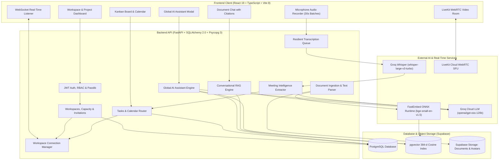
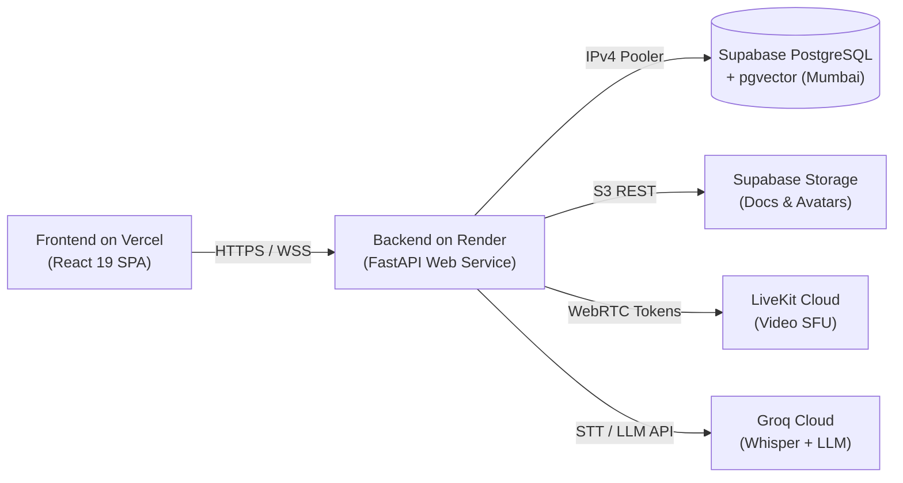

<div align="center">

# ⚡ Sync AI — All-In-One AI Productivity & Collaboration Workspace

### *Where Project Management, Real-Time Video, Smart Docs, and Autonomous AI Meet.*

[](https://sync-ai-productivity-platform.vercel.app)
[](https://render.com)
[](https://supabase.com)
[](https://fastapi.tiangolo.com/)
[](https://react.dev/)
[](docs/PRODUCTION_RELEASE_AUDIT.md)
[](LICENSE)

<br/>

[🚀 **Explore Live Demo**](https://sync-ai-productivity-platform.vercel.app) · [📖 **Production Release Audit**](docs/PRODUCTION_RELEASE_AUDIT.md) · [✨ **Feature Tour**](#-key-features) · [⚡ **Quickstart**](#-quickstart-in-3-minutes)

<br/>

</div>

---

## 💡 The Big Idea

> **Have you ever lost 20 minutes looking for notes from last Tuesday's meeting?**  
> Or wondered which document has the API credentials, while switching between Slack, Jira, Zoom, and Google Drive?

Modern product teams suffer from **context fragmentation**. Important commitments are forgotten in video calls, documents get disconnected from tickets, and team members waste hours searching for project context.

**Sync AI solves this by combining the entire team workflow into one unified, intelligent hub:**

| ❌ The Old Disconnected Way | ⚡ The Sync AI Way |
| :--- | :--- |
| Jump between 5 different browser tabs and apps | **One unified workspace** for tasks, docs, and video calls |
| Transcripts buried in Zoom or forgotten recordings | **Automatic Groq Whisper AI transcription** in 30-second live chunks |
| Manually writing down meeting tasks | **AI automatically extracts action items** with human approval before saving |
| Guessing answers or hallucinated AI responses | **Verified RAG with exact document citations** (chunk IDs & source links) |
| Outdated screens needing constant manual refresh | **Instant bidirectional WebSocket sync** across all active team windows |

---

## 📸 Visual Tour

<div align="center">

### 🏢 Team Workspaces & Central Dashboard
*Multi-tenant workspace governance, capacity seat tracking, invite links, and fast QR code joining.*


<br/>

### 📋 Interactive Kanban Board & Workflow Engine
*Drag-and-drop status transitions, priority badges, deadline tracking, and instant WebSocket broadcasts.*


<br/>

### 📹 Real-Time Video Meetings & Audio Stream
*Built-in WebRTC video conferencing powered by LiveKit Cloud with live speaker badges and media controls.*


<br/>

### 💬 Grounded Conversational RAG with Citations
*Multi-turn document chat strictly grounded in indexed project documents with verified page citations.*


</div>

> 🔎 **More UI captures:** [Project Calendar View](docs/screenshots/calendar.png) · [Document Knowledge Library](docs/screenshots/documents.png) · [LiveKit Video Room](docs/screenshots/meeting-room.png) · [AI Meeting Extraction](docs/screenshots/meeting-results.png)

---

## 🛠️ System Architecture



---

## ✨ Key Features

### 1. 🧠 Global AI Assistant (Notion-AI Style Copilot)
- **Multi-Scope Intelligence:** Switch freely between **Global Account Scope** (all assigned tasks and meetings), **Workspace Scope** (team roadmaps and capacity), and **Project Scope** (specific tickets and files).
- **Zero Hallucination Guarantee:** Untrusted prompt delimiters defend against injection attacks; the assistant transparently admits when evidence is missing.
- **Instant Productivity Rollups:** Summarize your daily agenda, find bottlenecks, and get smart task recommendations in seconds.

### 2. 🛡️ Workspace Governance & Multi-Channel Invitations
- **Seat Capacity Limits:** Configure maximum seat caps (e.g. 50 seats) with live capacity meters and saturation warnings.
- **Multi-Channel Quick-Join:**
  - 🔗 **Secure Token Links:** Cryptographically hashed (SHA-256) one-click invitation URLs.
  - 🔢 **6-Digit Join Codes:** Easy-to-type alphanumeric codes (`xxx-yyy`) with collision prevention.
  - 📱 **Dynamic QR Codes:** Scan with your phone or camera to join instantly.
  - ✉️ **Direct Email Invites:** Dedicated invitations with verified recipient validation.
- **Admin Approval Gate:** Optional review queue allowing workspace admins to approve or reject prospective members.

### 3. ⚡ Bidirectional Real-Time WebSocket Synchronization
- **Zero-Refresh Workflow:** Moving a card on your Kanban board broadcasts an instant event through `/api/v1/workspaces/{id}/ws` to all collaborators.
- **Strict Tenant Isolation:** WebSocket streams are strictly scoped per workspace; Workspace A never sees events from Workspace B.
- **Keepalive & Reconnect:** 25-second heartbeat ping with exponential backoff and jitter (1s–10s) keeps connections alive through spotty networks.
- **Instant Revocation:** When an admin removes a member, their active WebSocket is terminated immediately (close code 1008).

### 4. 📚 Smart Knowledge Base & FastEmbed Vector Search
- **Multi-Format Ingestion:** Drag and drop `.pdf`, `.docx`, `.txt`, `.md`, or `.csv` files up to 10 MB.
- **Local ONNX Embeddings:** FastEmbed (`BAAI/bge-small-en-v1.5`) runs directly on the CPU inside the backend process, generating 384-dimensional vectors with zero external API fees.
- **Cosine Distance Filter:** Calibrated distance threshold (`RAG_MAX_DISTANCE <= 0.45`) discards irrelevant matches automatically.

### 5. 🎯 Conversational RAG with Inline Citations
- **Document Chat:** Ask questions in natural language and receive comprehensive answers strictly grounded in your project files.
- **Clickable Citations:** Every answer links directly to verified source chunk tags, file names, and page references.

### 6. 📹 WebRTC Video Rooms & AI Meeting Extraction (LiveKit + Groq)
- **In-Browser Video Calls:** Launch high-definition video rooms instantly via LiveKit Cloud without third-party plugins.
- **30-Second Audio Chunking:** The browser automatically records discrete audio slices, uploading them to a rate-limit resilient background queue.
- **Groq Whisper Transcription:** Generates millisecond-accurate transcripts attributed to speaking participants.
- **Human-in-the-Loop Approval:** The AI extracts executive summaries, decisions, suggested tasks, and follow-up calendar events—letting you approve or edit each item before it is committed to your Kanban board.

### 7. 🎨 Delightful Modern UI & Accessibility
- **Kinetic Text Reveals:** Elegant typographic animations built with screen-reader accessibility (`sr-only` preservation).
- **Hold-to-Delete Safety Buttons:** Visual countdown progress bars prevent accidental destructive deletions.
- **Dynamic Theme Engine:** Switch seamlessly between Dark, Light, and System themes with smooth CSS variable transitions.

---

## ⚡ Quickstart in 3 Minutes

### Prerequisites
- **Node.js** (v18.x or v20.x) & **npm**
- **Python** 3.10.x (tested on 3.10.14)
- **Git**

---

### Step 1: Clone the Repo
```bash
git clone https://github.com/Bhomaramsuthar/Sync-Ai-Productivity-Platform.git
cd Sync-Ai-Productivity-Platform
```

---

### Step 2: Set Up Backend
```bash
cd backend
python -m venv venv

# Windows (PowerShell):
.\venv\Scripts\Activate.ps1
# macOS / Linux:
source venv/bin/activate

pip install -r requirements.txt
cp .env.example .env
alembic upgrade head
uvicorn app.main:app --reload
```
> 🌐 Backend runs at: `http://127.0.0.1:8000`  
> 📖 Swagger API Docs: `http://127.0.0.1:8000/docs`

---

### Step 3: Set Up Frontend
Open a new terminal window:
```bash
cd frontend
npm install
npm run dev
```
> 🚀 Frontend runs at: `http://localhost:5173`

---

## 🧪 Testing & Quality Assurance

Sync AI includes a comprehensive, automated test suite covering authentication, RBAC, vector embeddings, meeting pipelines, and UI safety:

```bash
# 1. Run all 195 Backend Tests (FastAPI + SQLAlchemy + Mock/FastEmbed)
cd backend
pytest

# 2. Run all 29 Frontend Component & Logic Tests (Vitest + React Testing Library)
cd frontend
npm test

# 3. Verify TypeScript Production Build
cd frontend
npm run build
```

| Suite | Tests | Result | Coverage |
| :--- | :---: | :---: | :--- |
| **Backend Unit & API Tests** | **195** | ✅ **PASSED** | Auth, RBAC, RAG, Meetings, Invitations, WebSockets |
| **Frontend Unit & Component Tests** | **29** | ✅ **PASSED** | Capacity UI, Kinetic Reveals, Hold-to-Delete, Assistant Icons |
| **TypeScript / Vite Build** | **2,958 Modules** | ✅ **0 ERRORS** | Production bundle compiled in 691ms |

---

## 🚢 Production Deployment

Sync AI is designed for cost-effective deployment across modern cloud platforms:



- **Frontend:** Deployed to **Vercel** with client-side SPA rewrites in `frontend/vercel.json`.
- **Backend:** Deployed to **Render** via `render.yaml` with automatic Alembic migrations on deploy.
- **Database:** Hosted on **Supabase** (PostgreSQL + `pgvector` in Mumbai) accessed via IPv4 Supavisor connection pooling.
- **Pre-Release Audit:** For a detailed checklist of production variables, migrations, and rollback procedures, check out [`docs/PRODUCTION_RELEASE_AUDIT.md`](docs/PRODUCTION_RELEASE_AUDIT.md).

---

## 🔒 Security & Privacy

1. **Strict Multi-Tenancy:** Tenant isolation enforced at the database query layer (`get_project_for_member`). Unauthorized access returns `HTTP 403 Forbidden` or `HTTP 404 Not Found`.
2. **Stateless JWT Tokens:** Cryptographically signed using HMAC-SHA256 with passwords hashed using `bcrypt` (12 rounds).
3. **Private Object Storage:** Files are stored in a private Supabase Storage bucket with zero anonymous access. File downloads require time-limited signed URLs.
4. **Untrusted LLM Data Isolation:** All user-uploaded documents and transcripts are wrapped in untrusted data delimiters before prompting external LLMs to prevent prompt injection.
5. **No Blind AI Mutations:** AI models only suggest tasks and events; they never write directly to your database without explicit user approval.

---

## 🗺️ Roadmap & Future Vision

- [ ] Mobile PWA companion app with push notifications
- [ ] Collaborative real-time multi-cursor document editing
- [ ] Multi-speaker audio diarization in meeting transcripts
- [ ] Export meeting minutes to Markdown, PDF, and Notion
- [ ] Project velocity charts and automated team burndown metrics

---

## 🤝 Contributing

Contributions make open-source amazing! Any contributions you make are **greatly appreciated**.

1. Fork the Project
2. Create your Feature Branch (`git checkout -b feature/AmazingFeature`)
3. Commit your Changes (`git commit -m 'feat: add some amazing feature'`)
4. Push to the Branch (`git push origin feature/AmazingFeature`)
5. Open a Pull Request

---

## 📄 License

Distributed under the **MIT License**. See [`LICENSE`](LICENSE) for more information.

<div align="center">

**Built with ❤️ for modern product teams, students, and engineers.**  
If you find this project helpful, give it a ⭐ on [GitHub](https://github.com/Bhomaramsuthar/Sync-Ai-Productivity-Platform)!

</div>
